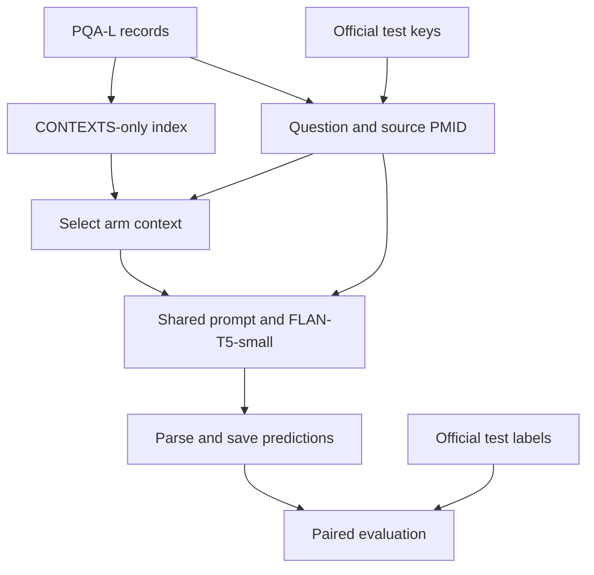

# PubMedQA evaluation protocol

**Version 1.0 · 14 November 2026 · Pre-test specification**

## 1. Study question and comparison

For one fixed FLAN-T5-small checkpoint, how many percentage points does supplying the top-1 TF–IDF result change yes/no/maybe accuracy relative to closed-book inference? The reference-context arm measures accuracy when the benchmark-provided abstract body is available. The unit of analysis is the question, linked by PMID across all three arms.

| Arm | Contents of the context slot |
|---|---|
| A · Closed-book | Empty string |
| B · TF–IDF top-1 | Highest-scoring positive-match PQA-L context body. Empty if every score is zero. |
| C · Reference context | PQA-L context body paired with the question's PMID |

## 2. Frozen data and exact partitions

Use the authors' [PQA-L records](https://github.com/pubmedqa/pubmedqa/blob/master/data/ori_pqal.json) and [official test ground truth](https://github.com/pubmedqa/pubmedqa/blob/master/data/test_ground_truth.json). Read only keys from the ground-truth file for split assignment. The file's label values are reserved for the evaluator. File fingerprints verified for this protocol:

| File | SHA-256 |
|---|---|
| `ori_pqal.json` | `8b3276be8942ebbd77f3ddcda12c1749bf0e490045a736fd8438ee40cf37a41d` |
| `test_ground_truth.json` | `939fe566f09017d13b1ca64d2ddfee0bc2374b366048152997669cccedc44d51` |

- **Final evaluation (500).** Use exactly the keys of `test_ground_truth.json`, joined to PQA-L by PMID and processed in ascending numeric PMID order. The pinned file defines the complete list.
- **Smoke (6).** Subtract official test keys from all PQA-L keys, sort the 500 remaining PMIDs numerically, and take positions 1–6: **1571683, 2224269, 2503176, 8017535, 8111516, 8200238**. Run all three arms for 18 smoke predictions.
- **Optional prompt checks (20).** Take positions 7–26 of the same ordering, disjoint from smoke: **8245806, 8262881, 8422202, 8985020, 9003088, 9044116, 9107172, 9140335, 9191526, 9278754, 9347843, 9363529, 9381529, 9444542, 9446993, 9550200, 9569972, 9602458, 9645785, 9745063**. Use only if smoke reveals a formatting or prompt interpretation problem. Record any prompt variants and rationale before test inference. If scoring these checks, join the non-test `final_decision` only inside evaluation.
- Assign membership using PMIDs alone. The numerical ordering provides reproducible engineering fixtures and may favor older studies.

## 3. Corpus and retrieval

Build one document per PMID from **all 1,000 PQA-L records**. Preserve the released order of `CONTEXTS`, strip leading/trailing whitespace from each segment, discard empty segments and join with a single newline. Require a nonempty joined body. Use exactly this representation for index construction, retrieved context, and reference context. The released CONTEXTS field supplies the abstract body with its conclusion removed. It can still contain informative results.

Keep article titles, document-side question fields, conclusions, LONG_ANSWER, LABELS, final_decision, and other metadata out of searchable documents and context slots. The only question-field use is the current item's exact QUESTION string as the required search query and shared question line in all prompts. Keep PMIDs as keys and audit metadata. Both labels and label-derived features are excluded from retrieval, prompt construction, and inference.

The paired abstract bodies for every official test question are **deliberately available as candidate documents**. This defines a fixed-corpus source retrieval task. Fit IDF once on all 1,000 context bodies. Selection receives the query only and uses the source PMID afterward for diagnostics. Arm C alone uses the PMID to fetch reference evidence.

| Setting | Fixed value |
|---|---|
| Implementation | scikit-learn `TfidfVectorizer`; sparse float64 matrix; fit once |
| Analysis | `analyzer="word"`, `lowercase=True`, `strip_accents=None`, `token_pattern=r"(?u)\b\w\w+\b"`, `ngram_range=(1,1)`, `stop_words=None` |
| Vocabulary | `min_df=1`, `max_df=1.0`, `max_features=None` |
| Weights | `binary=False`, `sublinear_tf=False`, `use_idf=True`, `smooth_idf=True`, `norm="l2"` |
| Ranking | Cosine similarity as the sparse dot product of normalized vectors. Select the largest positive score. For equal computed scores select the smallest numeric PMID. |
| All-zero query | Return no document and score 0. Set `zero_score=true` and `hit_at_1=false`. Run B with the empty context slot. Keep the question in every denominator. |

## 4. Matched inference and parsing

Pin both checkpoint and tokenizer to [Google FLAN-T5-small revision 0fc9ddf78a1e988dac52e2dac162b0ede4fd74ab](https://huggingface.co/google/flan-t5-small/tree/0fc9ddf78a1e988dac52e2dac162b0ede4fd74ab). Use the same template in every arm. Substitute the exact question and the arm's context body.

```text
Answer the biomedical research question with exactly one label: yes, no, or maybe.
Question: {question}
Context:
{context}
```

**Tokenization and truncation.** Cap each encoder input at 512 tokens including special tokens. Tokenize the fixed prompt prefix through the newline after “Context:” and the context body separately, both with `add_special_tokens=False`. Reserve the tokenizer's single-sequence special-token overhead. Use the rest of the budget for the leading context tokens. Combine the token lists and add the special tokens once using the tokenizer. Preserve the whole prefix and question. Fail the input check before inference if the prefix plus special tokens exceeds 512. Log original and retained context lengths. An empty slot contributes zero context tokens.

**Generation.** Use Transformers/PyTorch, one checkpoint instance in evaluation mode, inference mode, float32, batch size 1, `do_sample=False`, `num_beams=1`, `max_new_tokens=8`, and the pinned checkpoint's EOS, padding and decoder start IDs. Decode with `skip_special_tokens=True` and `clean_up_tokenization_spaces=False`. Use one device and software environment for the whole final run. If the device or environment must change after starting, restart all three arms in one environment and log the reason. Treat runtime failures as incomplete execution and retry with the frozen settings. Require all 1,500 predictions before reporting primary results.

**Parsing.** Strip outer whitespace, lowercase, remove at most one final ASCII punctuation character from `.`, `!`, or `?`, and strip trailing whitespace again. Accept exactly `yes`, `no`, or `maybe`. Empty strings, explanations, multiple labels, and other forms become `INVALID`. Keep raw output and count every invalid prediction as incorrect. The label “maybe” is a benchmark category.

## 5. Scoring and paired analysis

| Measure | Pre-specified definition |
|---|---|
| **Primary · Accuracy** | Exact matches divided by all 500 official questions, per arm. Primary comparison is B minus A in percentage points. |
| **Secondary · Macro-F1** | Mean of per-class F1 for yes, no, and maybe with zero for undefined per-class scores. Invalid predictions produce false negatives for the corresponding gold class. No fourth class enters the mean. |
| **Retrieval diagnostic · Hit@1** | Count B selections whose PMID equals the question's paired PMID, divided by 500. No selection counts as a miss. |
| Output validity | Invalid count and percentage per arm, plus a confusion table with an INVALID prediction column. Report zero-score count and percentage separately. |

For each contrast B−A, C−A, and C−B, let the item-level difference be correctness in the first arm minus correctness in the second. Report both discordant counts (wrong→right and right→wrong, second arm to first) and the net percentage-point change. Compute the primary 95% percentile interval with 10,000 paired resamples of PMIDs (NumPy `default_rng(2026)`, resample 500 indices with replacement each time, shared across arms). Report C−A and C−B as secondary descriptive contrasts.

Group the same question triples by B source-PMID hit or miss. In each stratum report the sample size, all three accuracies, B−A and C−B, and the C-versus-B correctness transition counts. On misses, report reference recovery as `B wrong / C right` divided by the number of B-wrong misses. If that denominator is zero, report NA. Tabulate the all-zero subset of misses. Source hits must give identical B/C input tokens and generated labels. B/A inputs and labels must likewise agree for all-zero queries. Check discrepancies before interpreting results. Hit/miss summaries are descriptive because the strata can differ in question difficulty.

## 6. Data flow and output



Save one prediction row per `run_id × split × pmid × arm`, with:

| Stage | Expected columns |
|---|---|
| Identity | `run_id, protocol_version, split, pmid, arm, context_pmid` |
| Retrieval | `top1_pmid, top1_score, zero_score, hit_at_1` (populate on B; join by PMID for summaries) |
| Input audit | `question_sha256, context_sha256, input_ids_sha256, input_tokens, context_tokens_before, context_tokens_used, truncated` |
| Inference | `model_revision, raw_output, parsed_label, invalid, inference_ms` |
| Evaluation join | `gold_label, correct` (added after prediction files are complete) |

Use null context PMID for A and B abstaining from retrieval, retrieved PMID for positive-score B, and source PMID for C. Keep a run manifest with source hashes, ordered split IDs, package versions, hardware, dtype, model revision, template, vectorizer parameters and decoding parameters. Save predictions before labels are joined.

## 7. Controls, limitations and pre-run checklist

Hold question wording, template, instructions, context normalization, encoder cap, truncation rule, generation settings, and parser fixed. Preserve the paired denominators even when retrieval yields no context or generation yields an invalid label. Only the context slot varies.

Absolute retrieval performance is conditional on a small fixed candidate pool and title-derived benchmark questions. Source-PMID match measures recovery of the designated source, and another abstract may provide useful evidence. Reference context can be ambiguous or truncated. FLAN-T5 training overlap is unresolved. Conclusions apply to this checkpoint and protocol. Label accuracy alone does not measure clinical utility, hallucination, or factual support for free-text claims.

- [ ] Verify both hashes, 1,000 unique numeric PQA-L keys, 500 unique test keys, and complete one-to-one joins. Validate test label values only in evaluation.
- [ ] Assert smoke and optional development ID sets match the frozen lists and share no test IDs.
- [ ] Audit the index and prompt builder for the field whitelist. Verify identical reference and retrieved text for the same PMID.
- [ ] Exercise a known tie, all-zero retrieval, a source hit, a long context, and parser accept/reject examples. Use non-test fixtures.
- [ ] Load the pinned checkpoint and run six smoke questions in all three arms. Verify 18 unique output rows, label validity accounting, context-only differences, and repeatability on a repeated input.
- [ ] If needed, run prompt checks on the frozen development IDs and log any change. Freeze and archive the final protocol, code revision and manifest before final-test inference.
- [ ] Produce 1,500 frozen test prediction rows, verify completeness and arm consistency, and then join gold labels for scoring.

Log later changes in the research decision log with date, protocol version, old and new rule, rationale, evidence, and whether any test outputs or scores had been seen. Keep earlier versions. Label any outcome-informed analysis exploratory and report its relation to the frozen protocol.
